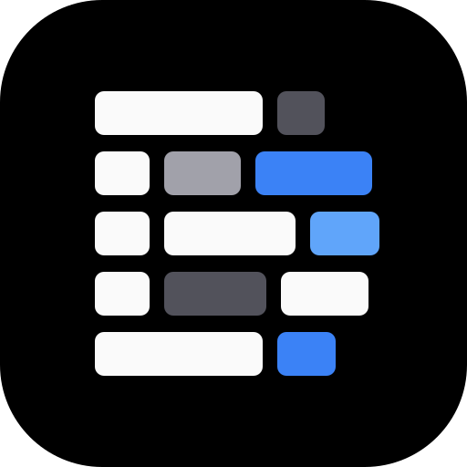

<h1> Drift</h1>

Drift is an editor for glitch art and pixel sorting of still photos. It runs entirely in your browser, works offline, and needs no account. Your photos never leave your device. Projects are saved in browser storage.

## What works today

- Import photos with a file picker or by dragging files onto the window. Several files can be imported at once. Any format your browser can decode works, such as JPEG, PNG, WebP, GIF, BMP and AVIF, and TIFF works too (the first page; 16-bit samples are reduced to 8-bit). An SVG is converted to a still image at its stated pixel size, or 2,048 pixels on its longest side if it states none; links to outside files in it are not loaded. An animated GIF, WebP, APNG or AVIF imports its first frame and shows a notice. HEIC/HEIF and camera RAW files are refused with a message saying what to convert them to. Images over 16,384 pixels on the longest side or over 200 MB are refused. Images over 50 megapixels offer a choice to import at 50 megapixels or import anyway.
- Paste a picture from the clipboard with Ctrl/Cmd+V on the Library or editor, or choose "Paste image" in the Library's top right menu or on the start screen. It follows the same rules as an imported file, and an unnamed picture becomes a project called "Pasted image". Pasting into a text field or over a dialog is left alone.
- Library of saved projects with thumbnails. Open, rename, duplicate and delete a project.
- Project files: "Save project file" in a Library project's menu or in the editor (on a phone, the menu at the top right) downloads one `.glproj` file holding the original photo, crop and size, effects, export settings and, unless you leave it out, the undo history. A progress bar has Cancel. Open the file with the import picker or by dropping it on the window: it becomes a new project, with "(imported)" added to a name that is taken. A damaged or newer file is refused with a message, and effects this version does not know are kept and reported.
- Backup and restore: "Export backup" writes the chosen projects, with or without undo history, your presets and your settings to one ZIP file of up to 4 GB. "Import backup" shows what a backup holds and which projects are new, unchanged or changed here, then merges it into the Library or, after asking, replaces the Library with it. Both are in Settings under Storage, in the Library's top right menu and, on a phone, in the editor's. A backup also opens when dropped on the window or picked with the import picker; a ZIP that is neither a backup nor a project file is refused with a message.
- A start screen while the library is empty: a drop zone, "Open images", "Paste image", "Try a sample" (a picture drawn by the app, so it works offline) and "Read the guide". On the first launch it also shows before and after previews of pixel sort, channel shift, slice shift and posterize; selecting one opens the sample with that effect. The previews go away when dismissed or after the first import.
- Geometry, under "Transform" in the editor: rotate by 90° and flip; crop with an on-canvas box (drag, aspect ratios, typed X, Y, width and height, arrow keys, Enter to apply and Escape to cancel); and resize in pixels or percent with an aspect lock and a choice of Lanczos-3, bilinear or nearest, up to 16,384 pixels per side and 50 megapixels. It is applied before the effects, never changes the original photo, and each change can be undone.
- Effect stack: add effects, turn each one on or off, reorder, duplicate and remove them.
- Pixel sort effect: sort direction by angle, selection by threshold range, edges or whole line, interval length with jitter and skip chance, channels (all RGBA, independent RGB, or red, green or blue only), sort key (luma, lightness, value, saturation, hue, red, green, blue), order (ascending, descending, shuffle, random direction), discretize, fill (sort, average, gradient), and interval transform (none, reverse, mirror, splice, fold).
- Channel shift effect: move the red, green and blue channels by separate offsets, with stretch or wrap at the edges.
- Channel swap effect: reassign the red, green and blue channels in any of the six orders.
- Slice shift effect: shift random bands of rows or columns sideways, with a band size range, a probability, a maximum offset, wrap or stretch at the edges, and a seed.
- Block shuffle effect: swap a random share of square tiles with other tiles, with a tile size, an amount and a seed.
- Posterize effect: reduce colour depth to a set number of levels per channel or by dropping low bits, with an optional monochrome output.
- Mirror fold effect: mirror the image left to right, top to bottom, four ways or as an eight-way kaleidoscope, around a movable centre, from either side.
- Bayer dither effect: ordered dithering with a 2×2, 4×4 or 8×8 pattern, 2 to 16 levels per channel, a spread amount, a pattern scale and an optional monochrome output.
- Threshold invert effect: invert all channels or one of them for pixels whose luma, lightness, value, saturation, hue, red, green or blue lies in a range, or outside it, with a selection view.
- Pixel smear effect: drag the colour of selected pixels along any angle in fading trails, with a selection key and threshold range, invert, trail decay, a maximum trail length and a "Show selection" view.
- Image blend effect: mix a second picture into the stack with one of ten blend modes, opacity, fit (cover, contain, stretch, tile or original size), scale, offset and rotation. Pick the picture from your device, under the same import rules as a photo, or take the original photo of another project; it is stored once, and picking and clearing can be undone. Effects above it change the photo only, effects below it the blended result. A project can use up to 8 extra pictures, project files carry them, and presets leave them out.
- Scanline wave effect: displace rows or columns along a sine, triangle, square or sawtooth wave, with amplitude, wavelength, phase, per-line jitter with a seed, and wrap or stretch at the edges.
- RGB noise effect: add colour or monochrome noise with an amount, a grain size, a chance of dead or hot pixels, and a seed.
- JPEG crush effect: crush 4 to 64 px blocks like a badly saved JPEG, with a quality level, optional chroma subsampling, and seeded block corruption that bends colours. It gives the same output in every browser.
- Undo and redo, by toolbar buttons and by Ctrl/Cmd+Z, Ctrl/Cmd+Shift+Z and Ctrl+Y. Each step is named after the change, for example "Angle 90°". History holds 200 steps and survives a reload.
- History panel: a list of every step, newest first. Select one to jump to it, or use "Compare with this" to compare any earlier or redo step against the current edit in split or toggle compare without changing your history or stacks. Later steps stay listed until you make a new change. It is a History tab on desktop and tablet, and a History button in the toolbar on phones.
- Presets: eight built-in ones, and your own saved from the current stack. Apply one, add one to the stack, rename or delete your own.
- Parameter panel built from each effect's definition: sliders, a range slider, an angle control, switches, choice lists, a random seed, exact number entry, per-parameter reset, "Reset all" and a "Randomize" button that gives every parameter a random valid value. Each effect also has a mix amount and a blend setting.
- Preview canvas with zoom (including a Fit option) and pan, by wheel, keyboard and touch pinch.
- Masks: limit any effect to part of the photo by painting, by brightness or by another image, with feather, invert, a "Show mask" overlay (`M`) and a badge on masked effects. A painted mask can be filled or cleared. Project files and backups carry masks, presets keep brightness masks only, and an older version of Drift refuses a file that holds a mask.
- Mask brush: paint and erase a mask on the photo with a mouse, pen, touch or the keyboard, with size, hardness, strength and pen pressure. One stroke is one undo step, two fingers zoom and pan while the brush is on, and paint follows crop, rotate, flip and resize.
- Compare view: toggle or hold Compare (button or `\`) to view the original image, and split view (`S`) with a draggable and keyboard-operable divider, left/right or top/bottom (`Shift+S`).
- A separate effect stack for each side of the split view, with copy to the other side, swap sides, presets and undo for both, and export of either side.
- Responsive editor layouts: a fixed right sidebar on desktop, a resizable and collapsible docked bottom panel on tablet, and a collapsible right drawer on landscape phone. On a portrait phone the photo keeps most of the screen: a labelled toolbar and a row of effects sit under it, then a panel that shows one control at a time, picked by name, or all of them.
- Keyboard shortcuts are mentioned only where there is likely a keyboard: tooltips, menus and the guide name no keys on a phone or tablet without a pointer that can hover.
- Export as PNG, JPEG, WebP (WebP only where the browser can encode it), AVIF, BMP or uncompressed TIFF. JPEG, WebP and AVIF have a quality setting. A large photo can take several seconds or more to export as AVIF. Size is full, half, quarter or a custom longest side, with an optional output file-size limit (lowering JPEG, WebP or AVIF quality and scaling dimensions as needed). You can set the file name.
- Settings: theme (System, Light or Black), storage usage, storage protection status and a "Request protection" button that says whether the browser granted it and what to try if not, an "Install app" button when the browser offers installation, and links to the source code, issue tracker, licence and releases, a dialog listing the bundled third-party packages with a link to their full licence texts, and a changelog that works offline.
- A built-in guide (the question-mark button, Settings, or the `?` key) with a quick start, a reference of every effect and its settings, keyboard shortcuts (not shown on touch devices), and storage and privacy notes. It works offline.
- Offline use and installable PWA: after the first visit, the app loads, edits and exports offline via a precached service worker. When a new version is ready, a "Reload to update" toast appears without interrupting active edits.

## Not there yet

These are planned and not in the app.

- Cloud backup and sync through your own Dropbox or Google Drive.
- More pixel sort line shapes, such as concentric rectangles, circles, spirals and random walks.
- Animation and video.

The order of work is in [roadmap.md](docs/specs/roadmap.md) and the feature list is in [product.md](docs/specs/product.md).

## Try it

Drift runs at https://drift.bbay.dev.

To run it locally you need Node 22.18 or later (or 24.11 or later) and pnpm 12.15.0. The `vp` command comes from Vite+, which is a dev dependency, so `pnpm install` provides it. If `vp` is not on your path, put `pnpm exec` in front of the commands below.

```sh
pnpm install
vp run dev
```

`vp run dev` starts the development server. `vp run gui` builds the production version and serves it at http://localhost:4173.

## Supported browsers

- Desktop Chrome and Edge 120 or later, and Firefox 128 or later.
- Safari is best effort and is not tested.
- Phones and tablets get responsive layouts but are not part of acceptance testing.

## Privacy

The app makes no network requests at runtime and has no analytics. Exported files carry no EXIF or GPS data.

## Development

- `vp run check` runs lint, type check and unit tests.
- `vp run build` makes the production build in `dist/`.
- `vp run test:e2e` runs the Playwright tests on Chromium and Firefox. Run `vp run browser:install` first.

AI agents do the development under the rules in [AGENTS.md](AGENTS.md). Every pull request lists the models that worked on it.

- Specs: [docs/specs/](docs/specs/)
- Design: [DESIGN.md](DESIGN.md)
- Domain words: [CONTEXT.md](CONTEXT.md)
- Research on existing tools and engine options: [docs/research/](docs/research/)

## Contributing and reporting problems

Report bugs and ideas in the [issue tracker](https://github.com/bberka/drift/issues).

## Credits

Pixel sorting as a glitch technique comes from Kim Asendorf's ASDFPixelSort. The app's Settings screen says: "Pixel sorting lineage: inspired by Kim Asendorf's ASDFPixelSort." Notices for third-party packages are in the app under Settings, with the full licence texts in `THIRD-PARTY-NOTICES.txt` served by the app (also in [THIRD-PARTY-NOTICES.md](THIRD-PARTY-NOTICES.md)).

## Licence

MIT. See [LICENSE](LICENSE).
